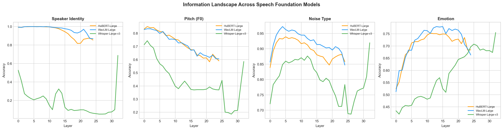
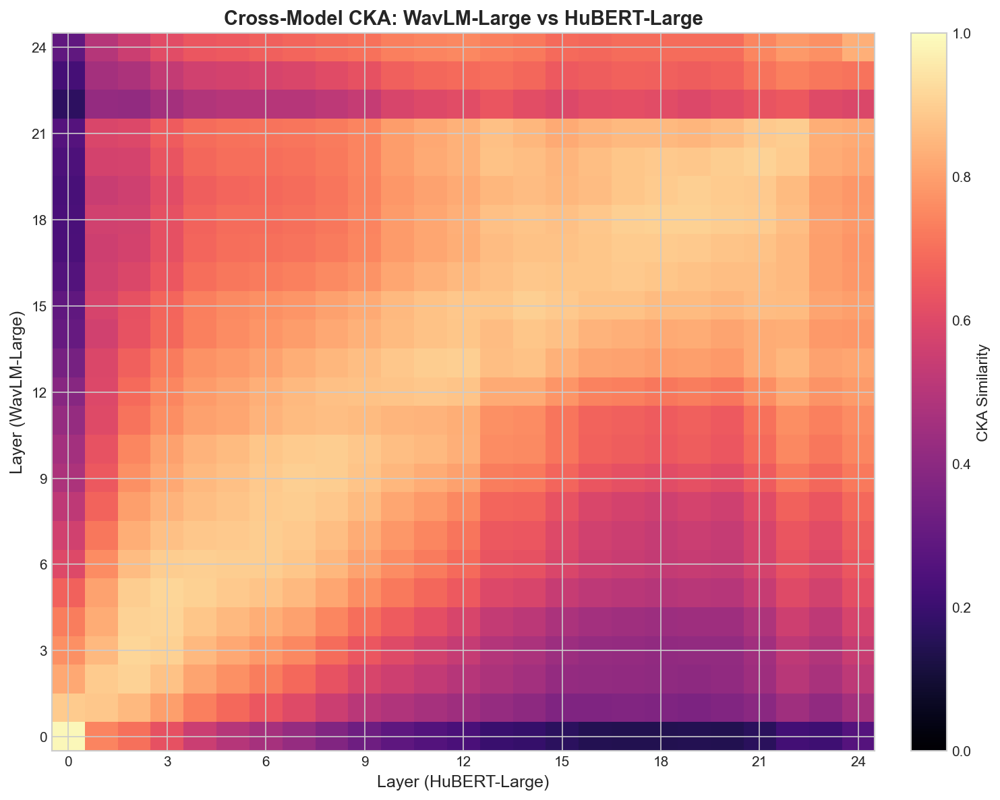
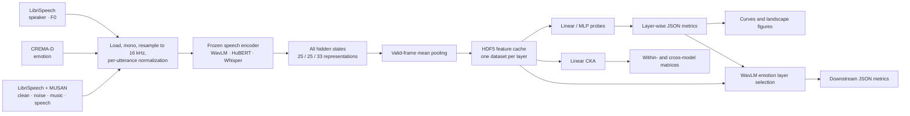

# Mapping the Information Landscape of Speech Foundation Models

**Layer-wise probing and representation-similarity analysis for WavLM-Large, HuBERT-Large, and Whisper-Large-v3.**

[](setup.py)
[](requirements.txt)
[](requirements.txt)
[](environment.yml)
[](#requirements)

[Overview](#overview) · [Results](#results) · [Pipeline](#pipeline) · [Installation](#installation) · [Experiments](#running-the-experiments) · [Project structure](#project-structure) · [Limitations](#reproducibility-and-limitations)

## Overview

This repository studies where four speech attributes are accessible across the hidden layers of three pretrained speech encoders:

- **Speaker identity** from LibriSpeech `train-clean-100`.
- **Pitch (F0)** as five utterance-level quantile bins derived with Praat/Parselmouth.
- **Acoustic condition** as clean speech or speech mixed with MUSAN noise, music, or speech at 10 dB SNR.
- **Emotion** as six CREMA-D classes with speaker-independent folds.

Each backbone is frozen. The pipeline extracts every hidden state, mean-pools valid frames, stores the resulting utterance representations in HDF5, and trains an independent linear or one-hidden-layer MLP probe at each layer. The same caches support linear CKA analysis and a downstream WavLM emotion-classification study.

### What is included

- A unified feature extractor for three Hugging Face checkpoints.
- Compressed, layer-indexed HDF5 feature caching with JSON metadata.
- Linear and MLP probes with validation-loss early stopping.
- Dataset builders for speaker, F0, noise-type, and emotion probing.
- Within-model and cross-model linear CKA.
- A downstream comparison of five WavLM layer-selection strategies.
- Committed probing JSON, CKA matrices, downstream metrics, and 18 generated figures.

> [!IMPORTANT]
> Raw datasets, model weights, and feature caches are not committed. The numerical results and figures under `results/` are committed.

## Results

The following figure is generated directly from the committed linear-probe result files.



### Best recorded linear-probe layer

Values are test accuracies from `results/probing/<property>/<model>_linear.json`. “Best layer” is the layer with the highest recorded test accuracy; layer 0 is the pre-transformer representation.

| Property | Majority baseline | WavLM-Large | HuBERT-Large | Whisper-Large-v3 |
|---|---:|---:|---:|---:|
| Speaker identity | 0.93% | **100.00%** (L4) | **100.00%** (L4) | 68.78% (L32) |
| Pitch (F0) | 22.49% | 83.46% (L1) | **85.13%** (L1) | 74.35% (L1) |
| Noise type | 28.75% | **97.22%** (L4) | 93.89% (L5) | 91.94% (L32) |
| Emotion | 17.07% | **77.96%** (L13) | 75.26% (L11) | 75.52% (L32) |

The committed curves show different layer profiles rather than a single universally useful depth: speaker and F0 information peak early in WavLM and HuBERT, their emotion peaks occur in the middle of the stack, and three of Whisper's four recorded maxima occur at its final encoder layer.

<details>
<summary><strong>Evaluation protocol and split sizes</strong></summary>

| Property | Source | Classes | Split strategy | Train | Validation | Test |
|---|---|---:|---|---:|---:|---:|
| Speaker | LibriSpeech `train-clean-100` | 205 speakers | Within-speaker 80/10/remainder split; at most 50 utterances per speaker | 3,804 | 408 | 647 |
| Pitch | LibriSpeech `train-clean-100` | 5 global F0 quantile bins | Random 80/10/remainder split | 4,292 | 536 | 538 |
| Noise | LibriSpeech + MUSAN | 4 conditions | Random 70/15/15 split | 3,360 | 720 | 720 |
| Emotion | CREMA-D | 6 emotions | Speaker-independent five-fold assignment; fold 0 test, fold 1 validation | 4,420 | 1,470 | 1,552 |

LibriSpeech and CREMA-D scans retain audio between 1 and 10 seconds. Noise data are generated from 1,200 source utterances per condition: clean, ambient noise, music, and speech.

</details>

### Downstream layer selection

`results/downstream/emotion_layer_selection.json` records a WavLM-Large emotion-classification comparison using the same speaker-independent CREMA-D split. Each fixed representation is read by a two-hidden-layer MLP with 512- and 256-unit hidden layers.

| Method | Layers | Accuracy | UAR | Macro F1 |
|---|---|---:|---:|---:|
| Learned weighted sum | All 25 | **79.51%** | **79.75%** | **79.57%** |
| Probing-guided single layer | L13 | 77.32% | 77.47% | 77.50% |
| Probing-guided concatenation | L13, L15, L14 | 75.52% | 75.83% | 75.48% |
| Final layer | L24 | 74.55% | 74.84% | 74.52% |
| Fixed early-layer control | L2 | 60.82% | 60.89% | 60.37% |

The probing-guided L13 classifier exceeds the final-layer classifier by 2.77 percentage points in recorded test accuracy. The learned weighted sum is the strongest method in this artifact.

> [!CAUTION]
> The probing script chooses its “best layer” by test accuracy, and the downstream script reuses that choice on the same test split. Treat this table as an internal analysis, not as an unbiased estimate of a layer-selection procedure on unseen data.

### Representation similarity

Linear CKA is computed on 1,000 shared LibriSpeech samples. The repository contains three within-model matrices and all three cross-model pairs.

| Cross-model matrix | Shape | Mean CKA | Maximum CKA |
|---|---:|---:|---:|
| WavLM-Large × HuBERT-Large | 25 × 25 | 0.6922 | 0.9846 |
| HuBERT-Large × Whisper-Large-v3 | 25 × 33 | 0.5682 | 0.8055 |
| WavLM-Large × Whisper-Large-v3 | 25 × 33 | 0.4495 | 0.7160 |

The means are computed over every layer pair in the committed `.npy` matrices.



## Pipeline



### Encoders

| Repository name | Hugging Face checkpoint | Transformer layers | Stored representations | Hidden size |
|---|---|---:|---:|---:|
| `wavlm_large` | `microsoft/wavlm-large` | 24 | 25 | 1,024 |
| `hubert_large` | `facebook/hubert-large-ll60k` | 24 | 25 | 1,024 |
| `whisper_large_v3` | `openai/whisper-large-v3` | 32 | 33 | 1,280 |

All backbone parameters have `requires_grad=False`. WavLM and HuBERT receive normalized waveforms directly; Whisper uses `WhisperFeatureExtractor` and its encoder. Models run in FP16 on CUDA, hidden states are converted to FP32, and the pooled cache is stored as compressed FP32 HDF5 datasets.

### Probe training

| Component | Implementation |
|---|---|
| Linear probe | One affine layer |
| MLP probe | Linear → ReLU → Dropout → Linear; 256 hidden units and 0.1 dropout by default |
| Optimizer | Adam |
| Loss | Cross-entropy |
| Early stopping | Minimum validation loss; patience 5 |
| Default run | Learning rate `1e-3`, batch size 256, at most 50 epochs, seed 42 |

## Installation

### Requirements

- Python 3.9 or newer; the provided Conda environment uses Python 3.10.
- A CUDA-capable PyTorch installation and an NVIDIA GPU. Experiment and training entry points currently select `device="cuda"` directly.
- Git and Git LFS for the CREMA-D downloader.
- A `wget` executable on `PATH` for `scripts/download_musan.py`.

Create the repository environment from the checked-in definition:

```bash
conda env create -f environment.yml
conda activate speech-repr
python tests/test_environment.py
```

The first model run downloads the selected Hugging Face checkpoint. The environment check verifies Python, PyTorch, CUDA execution, GPU detection, dependencies, disk space, and model configuration imports.

## Quick start

Run commands from the repository root.

```bash
# Download LibriSpeech train-clean-100
python scripts/download_data.py --dataset librispeech

# Extract/cache WavLM features and probe speaker identity across all 25 states
python scripts/run_probing.py \
  --model wavlm_large \
  --property speaker \
  --probe linear

# Rebuild figures from result artifacts
python scripts/generate_figures.py
```

The first probing run creates `features/wavlm_large/librispeech/utterance_level.h5` and `metadata.json`. Later LibriSpeech probes for the same model reuse that cache.

## Running the experiments

### 1. Prepare datasets

```bash
python scripts/download_data.py --dataset librispeech
python scripts/download_musan.py
```

`scripts/run_emotion_experiment.py` prepares CREMA-D on demand. Its downloader clones the CREMA-D repository, expects Git LFS audio files, and exposes `AudioWAV` at `data/raw/cremad/AudioWAV`.

### 2. Run the four probing tasks

```bash
# Speaker and pitch for all three encoders
python scripts/run_all_experiments.py \
  --models wavlm_large hubert_large whisper_large_v3 \
  --properties speaker pitch \
  --probes linear

# Four acoustic conditions at 10 dB SNR
python scripts/run_noise_experiment.py --model all --probe linear

# Six CREMA-D emotions
python scripts/run_emotion_experiment.py --model all --probe linear
```

Run one model/property/probe combination with:

```bash
python scripts/run_probing.py \
  --model hubert_large \
  --property pitch \
  --probe linear \
  --seed 42
```

Supported `scripts/run_probing.py` values are:

| Argument | Values |
|---|---|
| `--model` | `wavlm_large`, `hubert_large`, `whisper_large_v3` |
| `--property` | `speaker`, `pitch` |
| `--probe` | `linear`, `mlp` |
| `--seed` | Integer; default `42` |

The dedicated noise and emotion runners accept the same three model names plus `all`, and `linear` or `mlp` probes.

### 3. Run CKA and downstream validation

```bash
# Requires LibriSpeech caches for all three encoders
python scripts/run_cka.py

# Requires the WavLM CREMA-D cache and emotion linear-probe result
python scripts/run_downstream_validation.py

# Regenerate every available probing and CKA figure
python scripts/generate_figures.py
```

## Configuration

The files under `configs/` document model, data, extraction, probing, and training settings and are validated by `tests/test_config.py`.

> [!NOTE]
> The current experiment runners do not load these YAML files or expose a `--config` option; they construct the active settings in Python. Editing a YAML file alone does not change an experiment run.

`configs/probing/phoneme.yaml` is a design stub for 39-class frame-level phoneme probing. No phoneme dataset builder, accepted CLI value, cached result, or figure is present, so phoneme results are intentionally not reported here.

## Outputs

| Path | Contents |
|---|---|
| `features/<model>/<dataset>/utterance_level.h5` | Generated FP32 mean-pooled features, keyed as `layer_00`, `layer_01`, … |
| `features/<model>/<dataset>/metadata.json` | Generated model name, layer count, hidden size, utterance IDs, and frame counts |
| `results/probing/<property>/<model>_<probe>.json` | Split sizes, baseline, best layer, best accuracy, and per-layer metrics |
| `results/cka/*.npy` | Within-model and cross-model CKA matrices |
| `results/downstream/emotion_layer_selection.json` | WavLM layer-selection comparison |
| `results/figures/*.png` | Layer curves, normalized landscapes, cross-model plots, summary, and CKA heatmaps |

<details>
<summary><strong>Committed result inventory</strong></summary>

- Linear probing: 12 JSON files covering 3 models × 4 properties.
- MLP probing: WavLM speaker and emotion JSON files.
- CKA: 3 within-model and 3 cross-model matrices.
- Downstream validation: 1 WavLM emotion layer-selection JSON file.
- Figures: 4 layer curves, 4 normalized cross-model plots, 3 model landscapes, 6 CKA heatmaps, and 1 full summary.

</details>

## Project structure

```text
speech-representations/
├── configs/
│   ├── extraction/             # per-encoder reference settings
│   └── probing/                # speaker, phoneme, and emotion settings
├── data/
│   └── processed/              # empty placeholder; raw data are generated locally
├── results/
│   ├── cka/                    # committed .npy similarity matrices
│   ├── downstream/             # committed layer-selection metrics
│   ├── figures/                # committed plots and heatmaps
│   └── probing/                # committed layer-wise probe metrics
├── scripts/
│   ├── download_data.py
│   ├── download_musan.py
│   ├── run_probing.py
│   ├── run_speaker_experiment.py
│   ├── run_all_experiments.py
│   ├── run_emotion_experiment.py
│   ├── run_noise_experiment.py
│   ├── run_cka.py
│   ├── run_downstream_validation.py
│   └── generate_figures.py
├── src/
│   ├── analysis/               # CKA and visualization
│   ├── data/                   # dataset scans, splits, F0, and noise mixing
│   ├── evaluation/             # accuracy, F1, UAR, and confusion matrix
│   ├── models/                 # frozen encoders, probes, and HDF5 caching
│   ├── training/               # probe trainer and early stopping
│   └── config.py               # dataclasses and model registry
├── tests/                      # environment, config, extraction, cache, and probe checks
├── environment.yml
├── LICENSE
├── requirements.txt
├── setup.py
└── README.md
```

## Validation

The repository provides fast configuration checks, synthetic probe controls, and GPU/model integration checks:

```bash
# Configuration parsing and model registry
python tests/test_config.py

# Synthetic convergence, random-label, metric, and linear-vs-MLP checks
python tests/test_probing_pipeline.py

# CUDA model forward passes; downloads model weights on first use
python tests/test_feature_extraction.py --model all

# WavLM extraction → HDF5 → reload integration check
python tests/test_caching.py
```

`tests/test_environment.py`, the probe pipeline, feature extraction, and caching checks require CUDA in their current form.

## Reproducibility and limitations

- Result JSON files preserve split sizes, baselines, per-layer train/validation/test accuracy, best epoch, and training time for probing runs.
- Dataset sampling, split assignment, and probe initialization use seed 42 in the recorded experiment scripts.
- Exact repeatability is not guaranteed: CUDA deterministic algorithms are not enabled, and MUSAN segment cropping uses NumPy's global random generator rather than the locally seeded generator.
- Dependency files specify version floors rather than a complete lockfile. `environment.yml` pins Python 3.10 and NumPy below version 2.
- The experiment scripts currently require CUDA and do not provide a CPU command-line option.
- Speaker probing uses within-speaker splits; it measures classification among known speakers, not recognition of unseen speakers.
- The committed probing results report the layer selected by test accuracy. A separate selection split is required for unbiased model selection.
- The YAML configurations are not yet wired into the experiment entry points.
- A phoneme YAML exists, but the corresponding frame-level extraction and probing path is not implemented in this repository.

## License

This project is released under the [MIT License](LICENSE). Copyright © 2026 Fatemeh Khaki.
