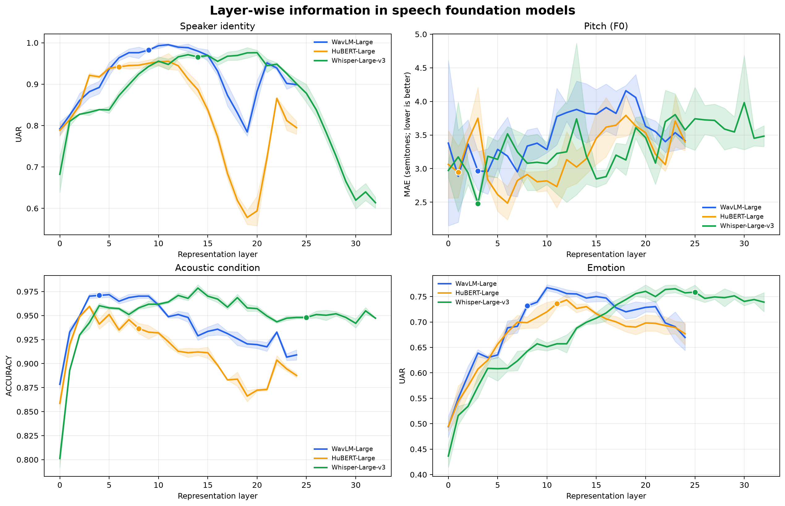

# Mapping Speech Foundation Model Representations

[](https://github.com/fatemehkhakii94/speech-representations/actions/workflows/quality.yml)
[](pyproject.toml)
[](environment.yml)
[](LICENSE)

A reproducible empirical study of **where speech information appears across the layers of
WavLM-Large, HuBERT-Large, and Whisper-Large-v3**. Frozen representations are evaluated on
speaker identity, continuous pitch, acoustic condition, and emotion; the same caches support
cross-model CKA and a probing-guided downstream validation study.

The repository is designed as a research artifact rather than a collection of one-off scripts:
one typed configuration, one CLI, deterministic data protocols, resumable provenance-checked
feature stores, validation-only model selection, multi-seed uncertainty, tests, and CI.



## Verified results

Layers are selected using the **validation split only**. The table reports mean test performance
over seeds 13, 42, and 77; `±` is the standard deviation across those runs. Layer 0 is the
pre-transformer representation.

| Task and metric | WavLM-Large | HuBERT-Large | Whisper-Large-v3 |
|---|---:|---:|---:|
| Speaker identity — UAR ↑ | **0.9823 ± 0.0000** (L9) | 0.9418 ± 0.0029 (L6) | 0.9657 ± 0.0053 (L14) |
| Pitch — MAE in semitones ↓ | 2.9655 ± 0.2862 (L3) | 2.9480 ± 0.3836 (L1) | **2.4802 ± 0.0421** (L3) |
| Acoustic condition — accuracy ↑ | **0.9709 ± 0.0026** (L4) | 0.9365 ± 0.0053 (L8) | 0.9480 ± 0.0013 (L25) |
| Emotion — UAR ↑ | 0.7317 ± 0.0046 (L8) | 0.7361 ± 0.0067 (L11) | **0.7588 ± 0.0137** (L25) |

The results support three useful conclusions:

- Information is not concentrated at one universal depth: the best layer changes by task and
  architecture.
- WavLM exposes speaker and acoustic-condition information especially strongly in early/middle
  layers, while Whisper produces the best held-out pitch and emotion scores in this protocol.
- Selecting representations matters downstream. WavLM's learned weighted sum reaches
  `0.7690 ± 0.0063` emotion UAR, and the validation-selected top-three layers reach
  `0.7675 ± 0.0022`, compared with `0.6791 ± 0.0220` for its final layer.

### Downstream WavLM emotion study

| Strategy | Layers | Test UAR |
|---|---:|---:|
| Learned weighted sum | all 25 | **0.7690 ± 0.0063** |
| Probing-guided top three | 8, 11, 12 | 0.7675 ± 0.0022 |
| Probing-guided single layer | 8 | 0.7208 ± 0.0166 |
| Final layer | 24 | 0.6791 ± 0.0220 |
| Early-layer control | 2 | 0.5811 ± 0.0152 |

This is evidence for the value of representation selection in this benchmark, not a claim of
state-of-the-art emotion recognition. See [Methodology](docs/methodology.md) for the precise
protocol and [Reproducibility](docs/reproducibility.md) for artifact guarantees and limitations.

## Study design

| Task | Dataset | Protocol | Train / val / test |
|---|---|---|---:|
| Speaker identity | LibriSpeech `train-clean-100` cohort | 24 known speakers; chapter-disjoint splits | 265 / 221 / 234 |
| Pitch | Same 720-utterance LibriSpeech cohort | median voiced F0 in semitones; speaker-disjoint splits | 480 / 90 / 150 |
| Acoustic condition | LibriSpeech + MUSAN | matched clean/noise/music/speech variants at 10 dB; source-grouped splits | 2,012 / 432 / 436 |
| Emotion | CREMA-D | 91 actors × up to 24 balanced utterances; actor-disjoint splits | 1,296 / 432 / 456 |

All encoders are frozen and pinned to immutable Hugging Face commit hashes. Valid-frame mean
pooling produces one vector per representation layer and utterance. Probes standardize features
with training statistics only; regression targets are also standardized from the training split
and inverse-transformed before reporting metrics. Early stopping uses validation loss, and the
test split is never used for layer selection.

## Quick start

The reference environment uses Python 3.11, PyTorch 2.6.0, CUDA 12.4, and an NVIDIA GPU. Model
weights and datasets are downloaded on demand and are intentionally not committed.

```bash
conda env create -f environment.yml
conda activate speech-repr
speech-repr doctor
```

Run the complete study:

```bash
speech-repr reproduce
```

The pipeline is resumable. Existing artifacts are reused only when their IDs, shapes, model
revision, data identity, configuration, and source fingerprint all match. Use `--overwrite` only
when intentionally replacing a compatible study:

```bash
speech-repr reproduce --overwrite
```

Run stages independently when developing or inspecting the project:

```bash
speech-repr prepare --tasks all
speech-repr validate
speech-repr extract --models all --datasets all
speech-repr probe --models all --tasks all
speech-repr cka --models all
speech-repr downstream
speech-repr figures
```

Selections can be comma-separated, for example:

```bash
speech-repr extract --models wavlm_large,hubert_large --datasets librispeech
speech-repr probe --models whisper_large_v3 --tasks pitch,emotion
```

## Engineering highlights

- **One source of truth:** `configs/project.yaml` is parsed into validated frozen dataclasses and
  drives every command.
- **Pinned backbones:** WavLM-Large, HuBERT-Large, and Whisper-Large-v3 use exact 40-character
  model revisions.
- **Correct pooling:** only valid encoder frames contribute to pooled WavLM/HuBERT features;
  Whisper uses its encoder attention mask.
- **Resumable storage:** HDF5 stores maintain per-row completion state, flush after each batch,
  and are atomically promoted only after completion.
- **Strict provenance:** cache fingerprints cover model/data identity, pooling, configuration,
  and executable source; result files additionally record package/GPU versions and input hashes.
- **Leakage controls:** speaker chapters, pitch speakers, noise source utterances, and CREMA-D
  actors are kept in exactly one split as appropriate for each research question.
- **Determinism:** seeded cohort construction, splits, noise generation, probe initialization,
  deterministic PyTorch algorithms, and the required cuBLAS workspace configuration.
- **Quality gates:** Ruff, mypy, 21 unit tests with branch coverage, GPU integration tests for all
  three real checkpoints, data validation, numerical audits, and GitHub Actions.

## Repository layout

```text
speech-representations/
├── configs/project.yaml              # canonical models, tasks, runtime, and training config
├── docs/                             # methodology and reproducibility notes
├── results/
│   ├── probing/<task>/<model>/       # layer-wise multi-seed JSON results
│   ├── cka/                          # aligned within/cross-model matrices
│   ├── downstream/emotion/           # representation-selection comparison
│   └── figures/                      # generated portfolio figures
├── src/speech_representations/
│   ├── data/                         # acquisition, cohorts, mixing, manifests, validation
│   ├── features/                     # frozen encoders and resumable HDF5 stores
│   ├── probing/                      # probes, training, metrics, layer selection
│   ├── analysis/                     # CKA, downstream study, plotting
│   └── cli.py                        # the `speech-repr` command
├── tests/
│   ├── unit/                         # deterministic fast tests
│   └── integration/                  # real-model GPU extraction tests
├── environment.yml                   # reproducible CUDA reference environment
└── pyproject.toml                    # package, tools, CLI, and dependency metadata
```

Generated datasets and feature caches live under `data/` and `artifacts/features/` and are
ignored by Git. Compact result JSON, CKA matrices, and figures are committed so the conclusions
remain inspectable without downloading the corpora or checkpoints.

## Validation

```bash
ruff check .
ruff format --check .
mypy src
pytest tests/unit --cov=speech_representations --cov-report=term-missing
pytest tests/integration -m "integration and gpu"
speech-repr validate
```

CI runs CPU-safe lint, format, type, unit, and coverage checks. The integration suite is kept
separate because it downloads large checkpoints and requires CUDA.

## Data and model sources

- [LibriSpeech / OpenSLR 12](https://www.openslr.org/12)
- [MUSAN / OpenSLR 17](https://www.openslr.org/17)
- [CREMA-D](https://github.com/CheyneyComputerScience/CREMA-D)
- [WavLM-Large](https://huggingface.co/microsoft/wavlm-large)
- [HuBERT-Large](https://huggingface.co/facebook/hubert-large-ll60k)
- [Whisper-Large-v3](https://huggingface.co/openai/whisper-large-v3)

Users are responsible for complying with each dataset and model's license and terms. No source
audio or model weights are redistributed by this repository.

## Documentation

- [Methodology](docs/methodology.md) — cohorts, splits, targets, extraction, probes, CKA, and
  downstream design.
- [Reproducibility](docs/reproducibility.md) — environment, provenance, artifact layout,
  verification, and known limits.
- [Contributing](CONTRIBUTING.md) — development workflow and acceptance checks.

## License and citation

Code is released under the [MIT License](LICENSE). Dataset and pretrained-model licenses remain
with their respective owners. Citation metadata are provided in [CITATION.cff](CITATION.cff).
